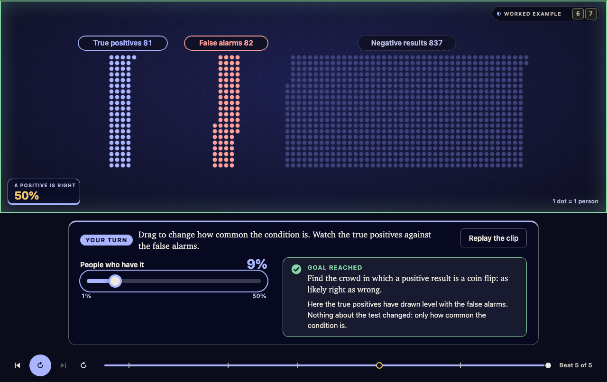

# Learning Tool

Tell your AI agent **"teach me X with Learning Tool"** and get back a short interactive lesson: animated clips you can play and scrub, predictions to make, sliders to drag, and a source behind every claim. It is one file that works offline.



## Install

For [Claude Code](https://claude.com/claude-code) (terminal or desktop app). Needs Node 20 or newer.

```bash
claude plugin marketplace add parodyband/learning-tool && claude plugin install learning-tool@learning-tool
```

## Use

Start a new session and say:

```
teach me how binary search works with Learning Tool
```

Your agent asks what you already know, researches the topic, builds the lesson and gives you a link.

## Good to know

- Your own agent does the thinking. Learning Tool runs on your machine and makes no network requests of its own.
- Every claim opens the passage it is based on. Learning Tool checks that claims point at saved passages; it cannot prove that the excerpt is genuine, so open the source when it matters.
- Other MCP hosts, optional voice narration, how it works and how to develop it: see [GUIDE.md](GUIDE.md).

MIT licensed. Motion craft references from Motion Design Skills by iart.ai (MIT); details in the guide.
